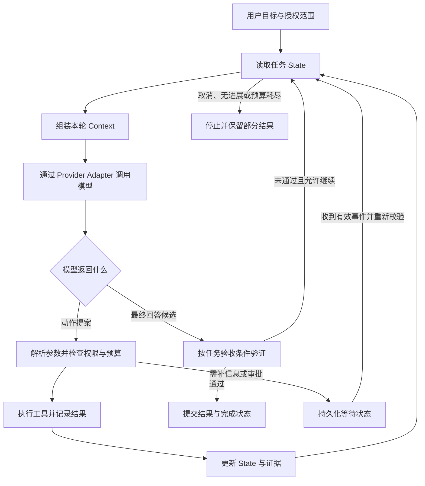

# 00.1 Agent 系统全景

先回答一件事：**如何让模型根据环境反馈选择下一步，同时把动作、权限、状态和任务完成控制在程序里？** 各专题分别展开这条链路中的关键边界。

## 一次任务怎样跑起来

图中省略了具体存储和框架。Trace 贯穿每个边界；长任务用持久化状态与调度恢复运行。验证失败时也要经过预算和停止判断，不能无限回到模型。

## 先分清这些对象

| 对象 | 它负责什么 | 它不能代替什么 |
|---|---|---|
| 用户目标与任务合同 | 目标、约束、可用资源、完成证据 | 不是一份已经执行的计划 |
| 模型 / Provider | 生成内容或下一步动作提案 | 不直接证明动作已执行或已授权 |
| Adapter | 把厂商消息、工具调用、流事件和错误转成内部类型 | 不负责业务验收 |
| Prompt | 告诉模型当前任务和行为要求 | 不构成权限执行边界 |
| Context | 本轮实际给模型的工作集 | 不等于全部历史或完整 State |
| State | 程序维护的任务阶段、事实、预算和待处理动作 | 不等于模型自由改写的摘要 |
| Memory | 为后续交互筛选保留的偏好、事实或经验 | 不取代业务数据库和授权事实 |
| RAG | 从知识源检索证据，再供生成使用 | 不保证召回、引用和结论必然正确 |
| Tool | 有输入输出合同的可调用动作 | 不等于模型选中了就能执行 |
| MCP | 宿主与工具、资源和提示模板服务之间的协议 | 不自动解决授权、幂等和任务恢复 |
| Skill | 按需加载的步骤、知识与配套资源 | 不天然具有更高指令优先级或额外权限 |
| Loop | 决定一轮之后继续、等待还是停止 | 不独立解决跨进程恢复 |
| Workflow | 由代码明确主要路径与分支的编排 | 可以使用模型和工具，不等于纯规则脚本 |
| Harness | 包围模型的运行支持、约束、验证和观测机制 | 不只属于多 Agent，也不只是沙箱 |
| 多 Agent | 具有独立上下文或运行边界的任务协作 | 不等于多个提示词、多个图节点或多次调用 |
| Checkpoint / Journal | 恢复快照 / 有序事件记录 | 不证明外部副作用没有发生 |
| Trace / Eval | 还原发生了什么 / 按标准判断效果 | 有日志不等于任务通过验收 |

这些是工程职责的划分；具体系统可以把几个职责放在同一模块里，不要求把每一行都部署成独立服务。

## 用一个代码修改任务串起来

用户要求修复一个函数，并保持现有接口。

1. **建立基线**：保存用户目标、已有修改、允许操作的目录、完成条件和预算。
2. **按需取上下文**：搜索目标函数、调用者、相关测试；不把整个仓库塞进窗口。
3. **模型提出修改**：返回受限 patch 或编辑提案。提案不代表文件已被修改。
4. **执行层检查并应用**：校验路径、当前文件版本、变更范围和授权；需要审批时等待有效批准。
5. **验证最终产物**：在实际修改后运行相关检查，记录 diff、工作目录、退出状态和失败信息。
6. **决定下一步**：通过则交付；失败但可修复时，依据失败事实继续处理；冲突、未知副作用、无进展或预算耗尽时停止或转人工。

同一链路可以先由一个 Agent 完成。只有独立审查、权限隔离或可并行子任务带来明确收益时，再拆多个 Agent。

## 五组最容易混淆的边界

- **提案 / 执行 / 证据**：模型生成参数，执行器改变环境，工具结果与验证器提供完成证据。
- **Context / State / Memory**：本轮输入、当前任务事实、为未来选择保留的信息，生命周期和写权限不同。
- **正常结束 / 成功完成**：没有新的工具调用，只说明模型停止；任务成功还要满足验收条件。
- **超时 / 已失败 / 结果未知**：没有收到响应不能证明没有执行；重试之前先判断幂等能力并核对外部状态。
- **角色 / 能力包 / 独立 Agent**：Planner、Critic 是职责；Skill 是可复用说明；是否拆成独立 Agent 是运行架构的选择。

Workflow 与 Agent 的选型参照 [Anthropic：Building effective agents](https://www.anthropic.com/engineering/building-effective-agents)；本页把这些概念组织成便于学习的职责图，不是一套框架 API 规范。
