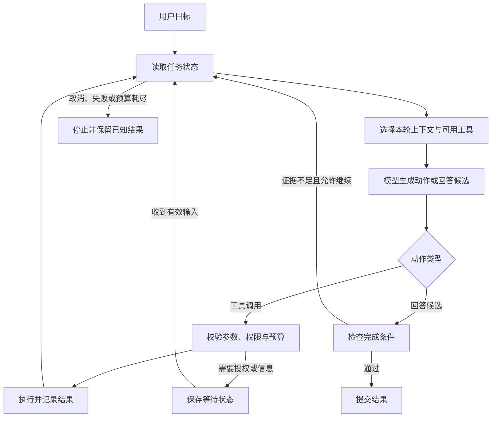

# 00 Agent 系统全景

首次阅读可按[阅读路线](00_02_阅读路线.md)进入各主题。[订单查询 Agent](案例_订单查询Agent.md)提供与本文对应的完整代码、三轮消息和运行结果。

Agent 根据目标和环境反馈选择下一步动作，应用程序检查提案后执行。程序把结果交回模型，模型再决定下一步；任务状态也随之更新。

模型根据输入生成文字或结构化动作提案，Provider 提供访问模型的接口与服务。三个常见术语也会贯穿后文：LLM 是大语言模型；Token 是模型处理和计量输入输出的基本单元；Schema 描述数据结构与约束。

配套 Python 案例以 3.12 为基线，可以逐轮查看提案、工具结果和状态变化。适配层负责转换 Provider 的协议字段。案例展示运行机制，真实模型的决策质量需要另用实际任务评测。

## 从一次模型调用到执行闭环

普通问答把输入交给模型，再展示输出。能够使用工具的 Agent 则可能先请求查询，读取结果后继续判断，直到给出答案或进入停止状态。模型生成工具参数时，外部世界尚未发生变化；执行器真正调用服务后，才产生结果或副作用。

模型调用失败、工具异常或等待超时时，程序会转入相应的错误分支，保存状态和原因；图中省略了这些分支。

## 关键对象与各自职责

| 对象 | 保存或处理的内容 | 典型边界 |
|---|---|---|
| Model | 内容生成与动作提案 | 提案不证明已执行 |
| Provider | 模型访问、消息与返回协议 | 服务响应成功不等于任务成功 |
| Context | 本轮实际提供给模型的信息 | 由程序按当前任务选择 |
| State | 当前任务阶段、事实和预算 | 关键字段由程序维护 |
| Memory | 为后续任务保留的信息 | 有来源、用途与生命周期 |
| Tool | 可执行的受限能力 | 参数合法不等于有权调用 |
| Loop | 一轮之后继续、等待或停止 | 需要明确终止条件 |
| Workflow | 用代码组织主要路径与分支 | 节点中也可以调用模型 |
| Harness | 准备模型输入、执行工具、管理循环与预算、检查结果并记录过程 | 范围因系统实现而异 |
| Checkpoint | 恢复运行所需的状态快照 | 不证明外部动作没有发生 |
| Trace / Eval | 记录发生了什么 / 判断效果 | 按任务标准评测，结果关联到对应轨迹 |

短任务可以在同一进程里用几个函数承担这些职责，串起模型调用、工具执行和结果检查。

## 一次任务中的数据与控制流

每轮开始时，程序从已有状态中选出模型需要的信息；工具执行后，再把新结果写回状态。具体读写顺序见[运行时机制与状态流转](01_基础架构/运行时机制与状态流转.md)。

调用轮数、Token、费用和总时间分别设限。Token 不等同于中文字数，工具 Schema、历史和协议内容也计入输入。输入处理与输出生成的成本差异见[模型与推理基础](10_模型与推理/01_模型与推理基础.md)。

## 一次订单查询

用户询问“订单 B 目前是否已发货”。程序保存查询目标和已认证用户身份，向模型提供查询订单的工具；模型提出包含订单号的查询请求，执行器核对用户是否有权读取该订单，再查询业务服务。得到 `status=shipped` 及更新时间后，模型组织回答，验证器检查回答中的订单号和状态是否与工具结果一致。

如果查询超时，程序应说明尚未取得状态，不能用模型常识补出物流结果。用户若改为“取消订单”，程序还要处理写操作，检查执行前的订单状态，并核对取消结果。

## 模型与程序的分工

模型适合理解自然语言、提出候选路径并组织解释。明确的规则与权限检查、金额运算、数据存储和状态更新，则适合交给程序。

验证器只能检查可观察的结果，例如记录是否更新、产物能否打开、引用是否支持结论。复杂报告的质量仍可能需要人工或经校准的模型评审。

同一个订单问题可以用普通函数、Workflow 或 Agent 完成，三种写法的比较见[Agent 基础与架构](01_基础架构/Agent基础与架构.md#同一个问题的三种控制方式)。

参考：[Anthropic 对 Workflow 与 Agent 的区分](https://www.anthropic.com/engineering/building-effective-agents)。
