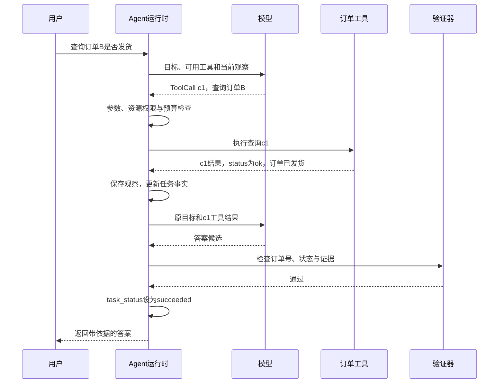

# 04 工具调用、MCP 与 A2A

[订单 Agent 完整案例](../案例_订单查询Agent.md)展示工具注册、参数校验、调用 ID 回填和结果核对怎样配合。本章后半部分继续介绍 MCP 与跨 Agent 协议。

## 从模型提案到工具执行

程序把工具名称、用途和参数结构交给模型。模型提出查询或修改请求，执行器检查后调用宿主函数或远程服务，把结果配回原调用 ID。真正的查询或修改发生在执行阶段。

工具描述要让模型看懂何时使用、传什么参数、会改变什么、返回哪些状态。名称相近或职责过多容易选错。工具较多时，先提供按权限筛选的目录，再加载相关 Schema；执行入口仍检查本次授权。

## 一次成功查询的时序



调用 ID c1 将提案、执行和结果关联起来。运行时把结果交回模型，由模型组织答案；验证器再核对答案与查询结果，确认后任务才完成。图中的验证器也可以是运行时里的一个函数。

## 用注册表限制可执行能力

注册表把工具名称映射到程序预先提供的处理器。模型返回字符串 lookup_order，只能定位到已有查询能力；不能把任意字符串当成 Python 代码或 Shell 命令执行。

| 提案 | 需要检查的内容 | 一种合理处理 |
|---|---|---|
| 已允许的订单查询 | 当前身份能否读取目标 | 返回受限范围内的结果 |
| 未注册的 delete_all | 工具是否存在且被允许 | 拒绝执行 |
| order_id 为数字 | 参数类型与字段规则 | 返回参数错误 |
| 合法参数但没有目标 | 当前可见资源集合 | 返回资源不存在 |

注册表挡住未知工具，参数模型挡住错误输入；当前身份能否访问目标资源，还要由执行器检查。

## 以业务意图设计工具边界

“读取工单”“按指定版本提交取消申请”直接对应业务动作，参数、权限、副作用和成功条件都比较容易界定。接受任意命令的工具，则很难逐项检查这些条件，模型选择动作的范围也更大。

写工具通常要带上资源 ID 和资源的预期版本。运行时还要关联一个业务操作 ID，用来识别同一次操作。业务服务在修改时检查订单是否仍未发货、版本是否未变等前提。读取后到提交前，状态可能已经变化，本地先查一次不能代替提交时的条件检查。

返回值区分“已接收”“已完成”“前置条件冲突”和“结果未知”。冲突后查最新状态，权限拒绝后核对授权。暂时不可用时，只有操作可安全重复且仍有预算，才考虑重试；完成则以回执或业务状态为依据。

业务系统异步处理请求时，工具可以返回操作引用，供后续查询进度。查询入口要确认它属于当前任务、调用者有权查看，并拒绝其他任务的操作 ID。

## 结果、错误与重试

参数不合法、权限拒绝、依赖失败和结果未知，需要不同处理。可修正的参数错误作为结构化结果交回模型；编程缺陷和含内部信息的异常由程序记录，对外返回适当说明，不能把堆栈直接放进上下文。

重试应继续关联原业务操作。结果未知时先回查该操作；只有明确允许重复且仍有预算时，执行器才重试。

结果太大时，可以让工具分页返回、只返回指定字段，或返回结果引用，并在读取时检查访问权限。若采用截断或摘要，要注明省略了哪些范围，避免模型把“没有返回”理解成“并不存在”。

## MCP 连接宿主与能力服务

MCP 规定宿主怎样发现和调用外部能力。Host 是使用模型的应用，负责用户交互；Client 与能力服务交换协议消息；Server 提供工具、资源和提示模板。

服务端用 inputSchema 声明入参，支持时也可以提供 outputSchema。业务审批、租户范围和幂等仍由应用实现。

应用可以按需要提供 Resources、Prompts、Tools。接收服务端描述、模板和内容时，按各自来源判断信任程度，避免将其中的外部文字直接当作执行指令。

## 传输版本与流式语义

固定协议版本后再实现传输。2026-07-28 的 Streamable HTTP 规范使用 POST，响应可以是 JSON 或请求范围内的 SSE；该修订移除了旧 GET 流端点和协议级 session。旧版实现需要独立兼容处理，不能直接套用相同续传逻辑。

SSE 描述事件流的表示方式，Streamable HTTP 规定 MCP 怎样通过 HTTP 传输消息。收到进度通知，并不表示工具正在逐段返回正文；最终结果还要完整配对、校验。

连接断开或等待被取消后，业务动作可能已经发生，撤销动作需要单独处理。

## Function Calling、MCP 与 A2A 的位置

Function Calling 让模型提出动作，MCP 连接宿主与外部能力服务，A2A 组织独立 Agent 之间的发现、消息和任务协作。普通内部函数或 API 已经够用时，可以继续沿用；引入协议还会增加版本、认证和排障工作。

跨 Agent 调用怎样传递身份、接收结果，见[身份与委托](../07_可靠性与安全/身份治理与跨Agent.md)。

## 从本地参数模型到协议消息

参数模型同时用于生成 JSON Schema 和校验输入，可以避免“描述接受某字段、执行器却拒绝”的冲突。

Messages API 的 input_schema 和 MCP tools/list 返回的 inputSchema 是不同协议字段，由适配器负责转换。

下面示意 2026-07-28 版本的 JSON-RPC 工具调用。这个版本要求每个请求在 params._meta 中带上协议版本和客户端能力，不能依赖旧连接的初始化状态。

HTTP 认证和版本兼容仍由 Client 处理。[每请求协议字段](https://modelcontextprotocol.io/specification/2026-07-28/basic/index#_meta)

```json
{
  "jsonrpc": "2.0",
  "id": 2,
  "method": "tools/call",
  "params": {
    "_meta": {
      "io.modelcontextprotocol/protocolVersion": "2026-07-28",
      "io.modelcontextprotocol/clientInfo": {"name": "example-client", "version": "1.0"},
      "io.modelcontextprotocol/clientCapabilities": {}
    },
    "name": "lookup_order",
    "arguments": {"order_id": "A"}
  }
}
```

```json
{"jsonrpc":"2.0","id":2,"result":{"resultType":"complete","content":[{"type":"text","text":"订单 A：pending"}],"structuredContent":{"order_id":"A","status":"pending"},"isError":false}}
```

这里 resultType="complete" 表示协议调用已返回完整结果，isError=false 表示工具未报告执行错误。它们描述的是工具调用，任务终态见[Loop 控制](../01_基础架构/Loop控制与Harness.md#区分工具结果、任务状态与停止原因)。

JSON-RPC 的 id=2 用来配对协议请求与响应，模型生成的 tool_use ID 用来配对模型消息。宿主需要保存两种 ID 的映射。工具成功返回 structuredContent 后，宿主将它转成发给模型的 tool_result。若服务端声明了 outputSchema，工具返回的结构还要符合它。

一轮返回两个工具提案时，分别按原调用 ID 回填结果，即使它们按不同顺序完成。输出被 max_tokens 截断时，先判为参数不完整，停止执行该提案。

参考：[MCP 工具规范](https://modelcontextprotocol.io/specification/2026-07-28/server/tools)、[Streamable HTTP](https://modelcontextprotocol.io/specification/2026-07-28/basic/transports/streamable-http)、[A2A 核心概念](https://a2a-protocol.org/latest/topics/key-concepts/)。
