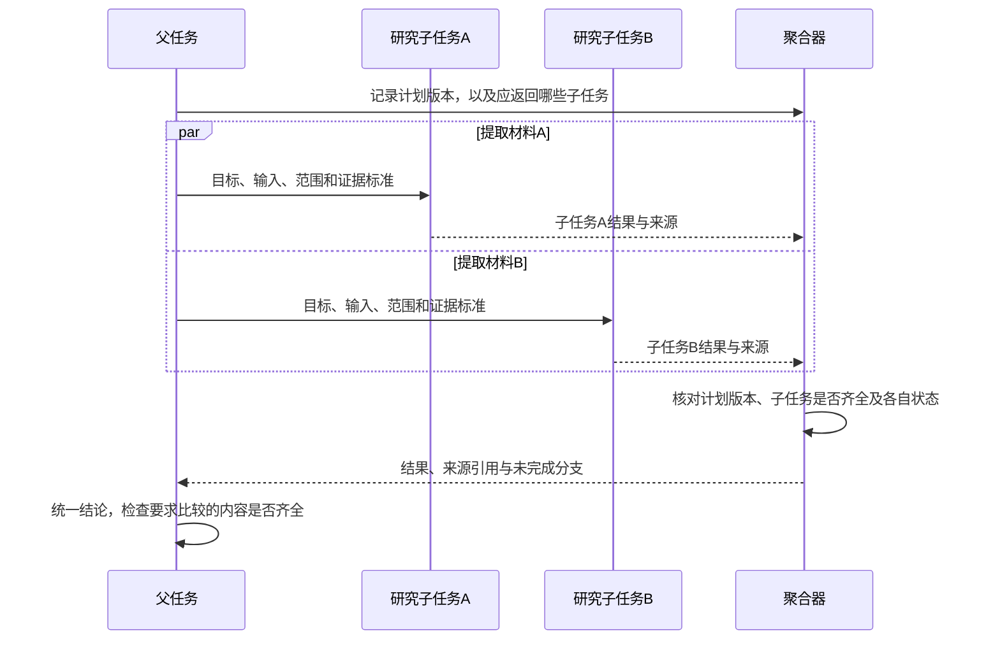

# 05.1 Workflow 与多 Agent 协作

## 固定路径和动态路径

多 Agent 可以按固定 Workflow 协作，也可以由模型分派子任务。确定的步骤用代码控制，需要根据新反馈选择的步骤交给模型，并为这一部分设置预算和返回格式。

多次调用模型完成路由、摘要和校验，仍可以只是普通 Workflow。执行者各自维护上下文、承担子任务或独立启动和结束时，才涉及 Agent 之间的协作。

## 角色与执行者

Planner 生成候选计划，Executor 执行动作，Critic 检查结果，Router 选择路径，Supervisor 组织分派与验收。这些职责可以由规则、普通函数、模型调用或独立 Agent 实现。

Critic 若与执行者读取同一份错误材料，也可能重复同一判断。为审查者提供明确标准、可检查产物和不同来源的证据，通常比单纯增加一个角色更有用。

## 父任务汇总子任务结果

以“根据两份制度材料形成对比说明”为例，父任务先确定比较哪些方面、需要什么证据，再把两份材料分别交给研究子任务。子任务提取相关条款并附上出处，父任务汇总后组织结论、处理矛盾。

A、B 两个子任务返回后，聚合器整理结果并标出缺口。父任务检查两份结果是否覆盖约定的比较内容、条款是否冲突，再决定补查还是整理结论。

## 约定子任务的输入与返回值

父任务交代目标、输入、可用能力、预算、期限和结果标准。子任务返回任务 ID、计划版本、结果状态、产物和证据引用；父任务按字段接收，不能用一段自由文本覆盖全部状态。

假设当前计划版本为 2，要求子任务 a、b、c：a 成功，b 失败，c 尚未返回，另有一份版本 1 的旧结果。汇总时只使用 a 的当前有效证据，将 b、c 标为缺口，旧版本结果不能进入当前结论。

同一子任务可能重复返回结果。先约定是拒绝重复结果，还是采用某次重试的结果。允许重试时，用任务 ID 识别子任务，用尝试编号区分它的各次运行，并记录最终采用了哪次结果。

所有子任务都返回 ok 后，父任务仍要检查两份制度是否可比、关键条款是否齐全。执行完成和比较内容完整，是两次不同的检查。

## 委托、交接与共享状态

Agent as Tool 把子 Agent 当成有输入输出的能力，主流程仍由父 Agent 控制。Handoff 则把后续会话或阶段交给另一个执行者，同时交代谁负责停止、取消、验收结果和向用户反馈。

共享黑板便于交换状态，也容易在并发修改时互相覆盖。独立子任务可以只交换消息和结果引用；需要共同写入时，采用单写者、事务或版本条件更新。进度保存到程序状态中，消息用于通知变化。

## 并行收益与协调成本

适合并行的是目标独立、权限允许且资源不冲突的任务。取消需要传递给已启动分支，聚合需要处理部分成功和迟到结果；总任务失败不意味着所有子任务都没有产生效果。

判断拆分是否值得，可以在相同任务分布和预算下比较单 Agent 与多 Agent，记录成功率、返工、延迟、费用和维护成本。去掉一个角色再跑一遍，也能看出它帮到了哪些任务。具体比较方法见[评测设计](../08_评测与可观测/评测设计与发布标准.md)。

## 分配预算并处理部分失败

父任务有六次模型调用额度，可以给两个子任务各预留三次。重试也占次数，费用则按实际用量另记；预留和未知用量的处理见[运行时状态流转](../01_基础架构/运行时机制与状态流转.md#调用前预留额度，调用后保存结果)。

一个子任务成功、另一个失败时，保留成功分支的证据。父任务只针对缺失部分补查、重试，或交付已有结果并说明缺口。

业务允许的失败，可以作为 failed 结果交给父任务处理。未处理的异常，则按所用并发 API 的规则向外传播。

退出前，按相应规则等待或取消其他分支，清理资源。父任务结合各分支的结果，判断整体业务状态；不同 API 的区别见 [Python TaskGroup](../../Python/02_语言进阶与异步.md#TaskGroup%20为什么会取消兄弟任务？)。
