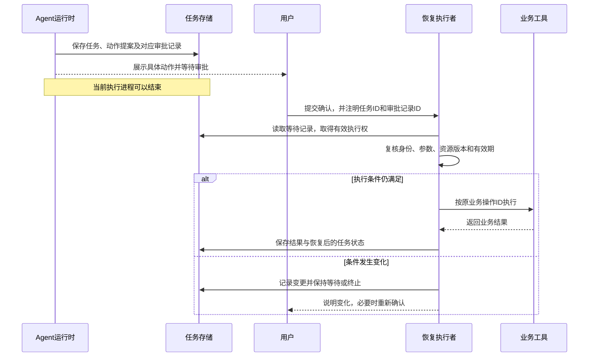

# 09.2 持久化执行与恢复

## 在进程结束后继续任务

任务等待审批时，服务可能重新部署；执行中也可能断网或崩溃。保存进度后，新的执行者可以接着处理，不必一直保留原进程。

pending 表示未开始，running 表示执行中，waiting_input 或 waiting_approval 表示等待输入或审批，succeeded 表示满足成功条件。failed、cancelled、expired 分别表示失败、取消和过期。已经取得的部分结果，以及执行结果尚不明确的外部动作，需要另行记录。

## 快照与事件记录

Checkpoint 保存继续任务的位置、所需状态及其版本；Journal 保存按顺序发生的事件和操作结果。

恢复前要核对快照对应的程序版本、执行图和策略。旧快照不兼容时，可以迁移数据、沿用旧执行版本，或明确停止恢复。

外部请求通常与图状态分开提交。恢复时重新进入节点，可能再次执行其中的不可逆动作，因此要为这些动作设计幂等和结果核对方式。

## 人工等待结束后继续同一任务

等待审批时可以释放进程，把提案和任务的关联持久保存。审批事件到达后，运行时恢复原任务，重新检查执行条件。

恢复后继续处理原目标，沿用原来的业务操作 ID。提案过期或条件变化时，重新确认具体动作，用户不必再描述整个需求。

## 模型调用与业务操作分别编号

模型重新规划后可能换一个 call_id，但处理的仍是同一笔取消。call_id 配对模型消息，operation_id 识别业务意图，资源版本用于检查操作前提，三者不能混用。

假设取消操作 O-7 将订单从版本 1 更新为版本 2，并保存输入与回执。响应丢失后，新执行者仍以 O-7 和原参数查询或重试，应取得原回执，不会再次修改订单。同一个 O-7 换成另一订单，则应被拒绝。

本地事务可以一起提交订单更新与操作记录。远端服务独立部署时，则由它提供幂等和结果查询接口；Agent 从检查点恢复后，通过这些接口核对远端结果。

## 未知结果与外部核对

进程调用下游后、保存本地结果前崩溃，可能留下“外部已完成、本地仍执行中”的状态。恢复时查询下游，或按原幂等键重取结果；查不清就保留 unknown，进入对账。

端到端 exactly-once 很难仅由消息系统提供。至少一次调度配合业务幂等是常见策略；不能安全重复的动作也可能选择不自动重试，代价是需要人工处理或可能漏执行。

## 用租约与运行代次确定接管者

模型请求尚未返回时，工作进程可能因租约到期而被接管，旧请求随后仍可能返回动作提案。新执行者需要拒绝这些迟到提案，旧工具结果也要检查版本后再决定是否更新任务。

每次接管，运行代次加一，这个编号也称 fencing token。状态更新时，同时核对任务、持有者、代次和有效期限，才能拒绝旧执行者的迟到提交。下表用简化时点说明执行权怎样转移。

| 时点 | 执行权状态 | 可以接受的提交 |
|---|---|---|
| 0，A 取得有效期为 10 个时间单位的租约 | A，代次 1，期限 10 | 有效期内的 A/1 |
| 10，原租约到期 | A/1 已失效 | 不再接受原代次 |
| 10，B 接管 | B，代次 2，新期限 20 | 当前有效的 B/2 |
| 11，A 的旧请求返回 | 仍为 B/2 | 拒绝 A/1 的迟到提交 |

代次用于识别执行权的新旧，租约用于限定有效期；两者需要共同检查。

领取任务时，存储层通过原子条件更新分配执行权；续租时检查持有者和代次。有效期由可信服务或存储层统一判定。执行权决定谁能提交，提交结果另做完成验证。

fencing token 由可信协调方在明确的作用域内单调发放，下游按相同作用域比较代次。不同任务各自的计数不能直接比较。

下游支持代次检查时，可以在修改资源时拒绝旧执行者；不支持时，任务数据库只能拒绝旧状态提交，外部副作用还需通过业务幂等、资源版本检查和结果核对处理。

队列可见性超时与租约有相似目的，但具体保证取决于服务。以 SQS 为例，消息处理时间过长时可延长可见性期限，标准队列仍可能重复投递，因此不能把消息不可见当成端到端只执行一次。[队列可见性与重复投递](https://docs.aws.amazon.com/AWSSimpleQueueService/latest/SQSDeveloperGuide/sqs-visibility-timeout.html)

## 用 Outbox 衔接提交与事件投递

Transactional Outbox 把审批确认状态和“继续运行”事件放在同一数据库事务中提交，再由后台进程发送事件。接收方把去重记录和本地状态一起提交；外部写入仍按原来的业务操作 ID 核对。崩溃后，就可以根据这些已提交记录继续处理：[Outbox 模式](https://docs.aws.amazon.com/prescriptive-guidance/latest/cloud-design-patterns/transactional-outbox.html)

| 崩溃位置 | 已知状态 | 恢复方式 |
|---|---|---|
| 状态与 Outbox 事务提交前 | 本次变更均未生效 | 按原业务操作 ID 重新处理 |
| 事务提交后、事件发送前 | 状态已更新，事件待发送 | 继续投递 Outbox |
| 事件已发送、发送确认未保存 | 下游可能已经收到 | 允许重发，由消费者按事件 ID 去重 |
| 外部动作完成、本地结果未保存 | 外部效果尚未被本地确认 | 查询原业务操作，避免盲目重复 |

## 隔离失败任务与控制补偿

持续失败的任务转入隔离区或死信队列，保存原因、输入版本、尝试记录和已执行结果。修复后，核对当前授权、有效期和资源状态再运行；审批过期就重新申请。

多步骤业务需要逐项约定补偿方式。例如取消申请已成功、通知发送失败时，保留已经成功的取消结果，后续只重试通知或转人工处理。每个动作记录自己的业务操作 ID 与结果，整体状态反映部分完成情况。

转人工对账后，逐项保存未知操作的核对结论与回执。自动恢复时，再按这些已经核实的业务状态继续。

## 备份恢复仍要对账

RPO 规定数据丢失的目标时间窗口，RTO 规定恢复服务的目标时长。任务状态、操作账本、事件和产物可能采用不同备份机制，恢复方案需注明各自的时间点，以及数据不一致时的核对方式。

恢复旧数据库快照不会撤销已经发出的邮件或业务写入。服务重新开放执行前，应核对恢复窗口内的外部操作，阻止旧事件和旧审批再次触发动作。恢复演练同时验证进程启动和外部状态核对。

## 恢复证据与诊断回放分开

恢复真实任务，沿已验证的结果和待处理动作继续。诊断“取消后仍重复取消”时，则固定记录，只运行决策与停止逻辑。入口必须区分真实执行和诊断模式，避免回放再次提交外部动作。

## 按已保存的进度选择恢复位置

结果尚未落库时，只读查询可以重查，写操作先按原业务操作 ID 核对下游。消息和结果已经完整保存时，核对当前授权、资源版本和制度后，从下一阶段继续。调用额度可能已被预留或消耗，用量未知的部分仍需对账。
