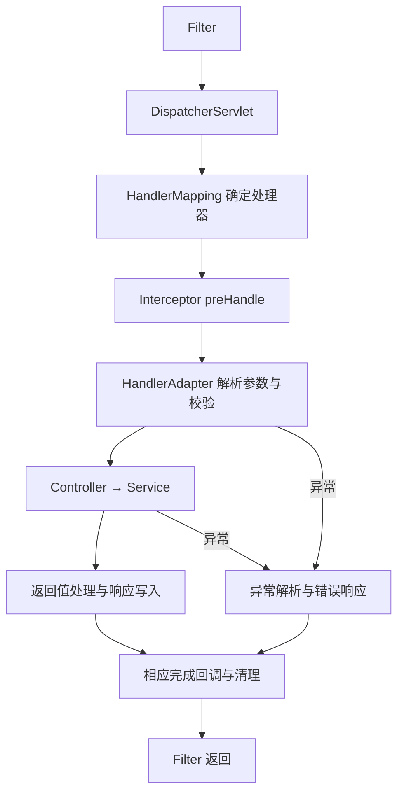

# 09 Spring Web 与 Boot

Spring MVC 把 HTTP 请求映射成应用调用，Spring Boot 则组织依赖、自动配置、外部配置和启动。两者常一起使用，但分别解决请求执行与应用装配的问题；理解先后关系，才能知道输入错误、配置错误和业务异常分别停在哪一层。

## MVC 请求处理链

以下是同步 Servlet MVC 的责任链。HandlerMapping 找到处理器和拦截器，HandlerAdapter 组织参数解析、校验、控制器调用与返回值处理；参数绑定失败时，Controller 和 Service 可能根本没有执行。

异常解析是失败分支，不是所有正常响应都再走一次 ExceptionHandler。拦截器的后置与完成回调还有各自条件，异步派发会增加阶段，不能只按图中的同步路径推断回调次数。

## Filter、Interceptor 与 AOP

Filter 位于 Servlet 入口，适合协议、请求包装、通用安全头等；Interceptor 工作在 MVC 处理器链，能够访问其上下文；AOP 作用于经过代理的 Bean 方法。一个机制能看到的范围，不自动覆盖另一个机制的全部入口。

认证与资源授权应在明确的安全边界执行，不能仅凭某个 MVC 拦截器就认为上传、错误派发、其他 Servlet 与方法调用均已覆盖。日志、Trace 和错误处理也要确定责任，避免每层重复记录同一件事。

## 身份、授权与异步入口

Authentication 表达认证请求或已建立的身份，SecurityContext 保存相应身份上下文，授权再判断主体是否可对具体资源执行动作。URL 规则不能替代资源归属判断，密码编码、Token 校验与注销也有各自的行为约定。[Spring Security 认证架构](https://docs.spring.io/spring-security/reference/servlet/authentication/architecture.html)

浏览器跨源读取、自动携带 Cookie 的请求、服务端资源授权是不同边界，应分别设计 CORS、CSRF 与授权规则，机制见[应用安全](../Architecture/应用安全.md)。异步、消息和定时任务则需明确工作负载身份，以及是否受控携带用户委托，不能把可复制的日志字段视为授权结果。

代理模式下的 @Async 同样需要调用经过有效代理；执行器容量、排队、拒绝、异常与上下文恢复应共同定义。把工作提交出去，只表示调度发生，不等于工作完成或业务事实已经持久化。

## Web 接口合同

请求 DTO 保存协议形状，字段格式与范围校验再建立可接受输入，业务层验证状态和资源权限。响应 DTO 则只暴露接口约定允许的数据，不直接把持久化实体及懒加载关系发给客户端。

分页、排序、过滤、上传与幂等写各有边界：限制页大小、允许字段与文件资源，定义同一幂等键的重复响应和过期行为。可预期业务错误返回稳定的错误结构，未知错误保留内部诊断并隐藏对外堆栈；输入合法也不等于业务动作已被授权。

## Boot 与 Framework 的职责

Boot 通过 Starter 组织依赖，通过条件自动配置提供默认能力，再结合外部化配置、嵌入容器、打包与 Actuator 帮助应用运行。Starter 主要是依赖组织，真正创建 Bean 的条件逻辑在相应配置中，不能只引入一个名称就推断全部能力已启用。

### 启动注解与自动装配

SpringBootApplication 组合配置类、组件扫描与自动配置能力。组件扫描按配置范围寻找应用组件，自动配置从候选列表选择配置并判断 classpath、现有 Bean、属性与运行环境；它们不是同一种扫描。

Boot 2.7 引入 META-INF/spring/org.springframework.boot.autoconfigure.AutoConfiguration.imports 注册自动配置候选，Boot 3 的相应注册采用此机制；旧版本通过 spring.factories 中的 EnableAutoConfiguration 条目注册。spring.factories 仍可用于其他扩展，不能把旧教程的候选注册方式与新项目混用。[Boot 2.7 自动配置注册](https://docs.spring.io/spring-boot/docs/2.7.18/reference/htmlsingle/#features.developing-auto-configuration.locating-auto-configuration-candidates)

用户定义 Bean 能否替换默认能力，要看具体条件与配置顺序。诊断先确认候选是否加载、条件是否匹配、Bean 的名称与类型是否符合预期，而不是反复增加 ComponentScan 范围。

## 配置来源、优先级与诊断

配置来源、激活 Profile 与绑定对象共同决定有效值。默认值、文件、环境与命令行等有具体优先规则，应按使用版本查看有效来源，不能只读一个 application.yml 就认定运行值。

把属性绑定为有类型对象，在启动时校验必填项、范围与关联条件。动态刷新还要确定哪些资源可安全替换、同一请求能否得到一致快照，配置与凭据的边界见[配置、密钥与环境治理](../Architecture/配置、密钥与环境治理.md)。

## ApplicationRunner 与启动任务

ApplicationContext 刷新后，Boot 在 SpringApplication.run 返回前执行 ApplicationRunner 与 CommandLineRunner；完成这些 Runner 后再发布相应 Ready 事件。ApplicationRunner 接收解析后的 ApplicationArguments，CommandLineRunner 接收原始字符串参数。

Runner 适合有边界的启动检查，未处理失败会影响启动结果，长期阻塞会拖延就绪。它不同于单个 Bean 的初始化回调，也不是每次 HTTP 请求的入口。嵌入服务器可能已绑定端口，只有流量入口遵循就绪信号，才真正避免过早路由。[Boot 启动事件与 Runner](https://docs.spring.io/spring-boot/3.5/reference/features/spring-application.html)

## 就绪、存活与优雅关闭

liveness 关注进程是否需要重启，readiness 关注当前能否接收流量。短暂下游故障不应不加区分地转成自身反复重启，否则可能进一步放大压力；具体探测应与服务恢复机制匹配。

关闭时先撤销就绪并停止接收，再有界排空请求和任务，最后释放依赖资源。Actuator 等管理端点独立保护，应用版本、配置版本与观测上下文也应能关联到真实实例。

## Starter 的扩展边界

通用 Starter 应提供明确属性、条件默认 Bean、用户覆盖路径和诊断信息，并验证依赖存在或缺失、配置启用或关闭的组合。它负责装配能力，不应在用户未明确启用时悄悄执行不可控业务动作。

## Spring AI 与模型调用

Spring AI 的模型客户端、Advisor 与工具集成把模型接入 Spring 生态，但独立版本和模型供应商仍有各自的行为约定。先按项目依赖确认 API，再区分模型输出、结构校验、工具授权、外部副作用与预算。

Flux<String> 表达发布者，并不会只因返回类型就自动成为正确的 SSE 协议。流式接口还要明确媒体类型、事件帧、刷新、缓冲、客户端断开与取消；结构化输出也不能替代业务与权限校验。

Spring AI 与 LangChain4j 等方案可按现有工程、所需能力与维护成本比较。工具、RAG 与生产控制的机制分别见[Tool Calling](../Agent/04_Tool与协议/Tool%20Calling与MCP.md)、[RAG](../Agent/06_RAG与知识库/RAG与检索.md)和[生产工程](../Agent/09_工程化与系统设计/01_生产工程与系统设计.md)。

## 框架代码的验证范围

代码辅助工具可以生成候选实现，但依赖版本、自动配置条件、代理路径与事务语义仍需通过编译和集成场景验证。最小用例至少能区分“类存在”“Bean 被注册”“调用经过代理”“真实资源提交”这几个阶段；构建成功不能替代后面三项证据。
